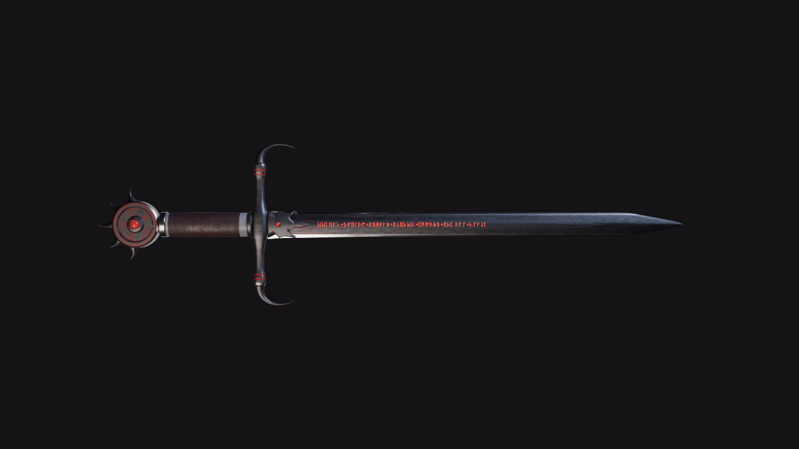

# Bloedgeas — Custom Sword for The Witcher 3 (5.01c)

A vampire-themed **relic steel sword** for The Witcher 3: Wild Hunt — Remastered **5.01c**, with a custom blade and scabbard, red runes, bleeding, combat regeneration, custom audio, and automatic level scaling.

“Bloedgeas” is presented in the mod's original lore as a blood-oath: a dark Mahakaman blade whose runes feed the hand that wields it.



**[Download the latest release](https://github.com/0xra0/Bloedgeas/releases/latest)** · [Installation](#installation) · [How to use](#how-to-use) · [Troubleshooting](#troubleshooting) · [Source and rebuilding](docs/DEVELOPMENT.md)

## Features

- Custom sword and fitted scabbard with fang-shaped details, ruby accents, blade runes, and a pommel sigil.
- A separate `Bloedgeas` inventory item, custom inventory icon, and restored weapon description.
- Three enhancement slots and relic-quality statistics.
- A **35% chance** to apply an **8-second bleed to living human targets** on eligible melee hits.
- **0.4% of maximum vitality regenerated per second** while alive, in combat, and holding Bloedgeas.
- A rune flare and life-drain beam on bleed procs, limited by a **2.5-second visual/audio cooldown**.
- Blood-burst effects on killing blows, randomized custom hit sounds, and bleed sounds.
- Sustained rune glow and a heartbeat loop below **30% vitality**, while drawn in combat.
- Automatic scaling for existing and newly acquired copies in the player's inventory, using the bundled compatible Gear Level Scaling scripts.
- English and Ukrainian text. The installed snapshot also contains other language files containing the same English text; these are English fallbacks, not additional translations.

The current regeneration function is flat: low health activates extra visual and sound effects, but **does not increase the healing rate**. The in-game lore text describes a stronger near-death effect; that curve is not implemented in this snapshot. The life-drain beam is a visual effect; healing comes from the combat timer.

## Requirements and compatibility

| Requirement | Details |
| --- | --- |
| Game | PC installation targeting The Witcher 3: Wild Hunt — Remastered **5.01c**. Other patches have not been validated for this release. |
| Script support | A compatible **[The Witcher 3 Script Extender (TW3SE)](https://www.nexusmods.com/witcher3/mods/13837)** setup. Bloedgeas uses `@wrapMethod`, `@addMethod`, and `@addField`. Follow TW3SE's installation instructions for your game build. |
| Scaling | The included `modGearLevelScaling` compatibility snapshot is required by the current sword script. It provides `SGLSSettings` and `GLS_ScaleItem`. |
| Expansion assets | The life-drain effect references a **Hearts of Stone** (`dlc/ep1`) asset. Keep that expansion installed for the complete effect set. |
| Debug console | Needed to acquire the sword through the documented spawn command. |

TW3SE and the game/REDkit applications are **not included**. This release preserves a working modded installation snapshot; it is not a fresh-install certification for every combination of mods. The earlier local runtime check verified scaling and compilation in that setup; see [Verification](#verification).

**Model replacement:** Bloedgeas is a separate item, but reuses the `dwarven_sword_lvl1` equipment template and `scabbard_steel_3_02`. Its mesh mod consequently also changes the appearance of the vanilla **Dwarven sword 1**. Another mod replacing those meshes or the same texture paths may conflict.

## Installation

### Manual installation

1. Close the game. Back up your saves and any existing `modVampSword`, `dlcvampsword`, or `modGearLevelScaling` folders before replacing them.
2. Install a TW3SE version compatible with your 5.01c game and confirm it loads correctly.
3. Download **`Bloedgeas-v1.0.0-Witcher3-5.01c.zip`** from [Releases](https://github.com/0xra0/Bloedgeas/releases/latest). The automatically generated GitHub source archives contain development files; the named ZIP is the installation package.
4. Extract the ZIP to a temporary directory. Copy its `mods` and `dlc` folders into the game root — the directory containing `bin`, `content`, and `dlc` — merging the folders when prompted. Create `mods` if necessary.
5. Keep all three components together. The final layout must be:

```text
The Witcher 3/
├── bin/
├── content/
├── dlc/
│   └── dlcvampsword/
│       └── content/
│           ├── blob0.bundle
│           ├── metadata.store
│           ├── texture.cache
│           ├── soundspc.cache
│           └── *.w3strings
└── mods/
    ├── modVampSword/
    │   └── content/
    │       ├── blob0.bundle
    │       ├── buffers0.bundle
    │       ├── metadata.store
    │       ├── texture.cache
    │       ├── soundspc.cache
    │       └── scripts/local/bloedgeas.ws
    └── modGearLevelScaling/
        └── content/
            ├── *.w3strings
            └── scripts/
                ├── local/ItemLevelScaling_main.ws
                └── game/
                    ├── components/inventoryComponent.ws
                    └── player/playerWitcher.ws
```

6. Resolve script conflicts with other installed mods before loading a save. The scaling snapshot includes full `playerWitcher.ws` and `inventoryComponent.ws` overrides; review merges carefully if another mod supplies those files. Do not install a second scaler copy under another folder name.
7. Launch the game and let script compilation finish. Load a save, allow gameplay to run briefly, then follow [How to use](#how-to-use).

Do not put these folders inside `bin`, `content`, or an extra nested `Bloedgeas/mods` directory. `README.md` and `SHA256SUMS` in the release ZIP are informational and can remain outside the game directory.

### Installing from a Git checkout

The repository's **`installed/`** directory contains the same runtime payload. Copy `installed/mods/` and `installed/dlc/` to the game root using the same steps above. Blender, Wwise, Python, and REDkit are not required to use the prebuilt mod.

A mod manager may install the package if it preserves this exact `mods/` and `dlc/` layout. Manual installation is the documented method; automatic manager detection has not been tested.

## How to use

### Enable the debug console

With the game closed, open `bin/config/base/general.ini` in the game directory and add the following line to its existing `[General]` section:

```ini
DBGConsoleOn=true
```

Save the file, start the game, and open the console with **~** (the key may vary with keyboard layout). This follows [CD PROJEKT RED's debug-console instructions](https://cdprojektred.atlassian.net/wiki/spaces/W3REDkit/pages/36208717/WS:%2BEnable%2Bdebug%2Bconsole%2Bin-game).

### Obtain and equip Bloedgeas

Enter this exact command and press Enter:

```text
additem('Bloedgeas')
```

Close the console, open your inventory, and equip Bloedgeas in the **steel sword** slot. The current item definition does not add a vendor, quest reward, or crafting recipe; console spawning is the documented acquisition method.

Draw the steel sword and enter combat to activate regeneration. Land melee hits against humans to trigger its bleed chance. At less than 30% vitality, the glow and heartbeat activate while the sword remains drawn in combat. Holstering the sword, leaving combat, or recovering above the threshold stops the low-health state on the next timer check.

`additem('Dwarven sword 1')` can demonstrate the shared model replacement, but that vanilla item **does not gain Bloedgeas's tagged script behavior**.

### Stats and scaling

| Property | Current value |
| --- | --- |
| Weapon category | Steel sword |
| Quality | Relic (`quality = 4`) |
| Baseline SlashingDamage | 369 before scaling |
| Attack power modifier | +10% |
| Critical hit chance modifier | +10 percentage points |
| Critical hit damage bonus | +60% |
| Human fatal-hit experience bonus | +5% |
| Enhancement slots | 3 |
| Weight | 4.9 |
| Durability | 100 |
| Bleed definition | `DirectDamage = 0.016`, duration 8 seconds; actual results depend on the game's effect handling and target resistances |

These values come from the [item definition](source/3D/KnightSword_vamp_v6_tex/dlc_src/pack/dlc/dlcvampsword/data/gameplay/items/def_item_bloedgeas.xml). The displayed damage range also depends on condition, other item attributes, and character bonuses.

The sword's timer runs every **0.5 seconds** and asks Gear Level Scaling to update every `Bloedgeas` copy in the player's inventory. Scaling is upward from the recorded baseline; it does not lower a higher-level sword to a lower-level character. Its Bloedgeas-specific eligibility exception works independently of the scaler's general enabled/swords/scope settings. Tracked `GLS2_*` item modifiers prevent the same upgrades being added repeatedly.

A previously saved level-42 copy was verified at player level 54: base damage rose from **369 to 465**, with **12 tracked upgrades of +8**. Existing copies do not need to be discarded and spawned again for this correction. After loading a save, let gameplay run briefly and reopen the inventory.

## Updating and uninstalling

**Update:** close the game, back up the existing mod folders, replace the three components with the matching release files, then revisit script merges. Load your save and wait briefly for the scaling timer. Avoid mixing an older `bloedgeas.ws` with a different scaler implementation.

**Uninstall:** make a backup save first. Unequip and remove custom sword copies before saving, then close the game and remove `mods/modVampSword` and `dlc/dlcvampsword`. Remove `mods/modGearLevelScaling` only if it was installed for this mod and no other setup relies on it. Restore prior script merges or scaler files as appropriate. Loading a save containing a removed custom item has not been validated; retain the backup.

## Troubleshooting

| Symptom | What to check |
| --- | --- |
| `SGLSSettings` or `GLS_ScaleItem` missing during compilation | Install the bundled matching `modGearLevelScaling` files and check for another mod overriding them. |
| Errors involving annotations or `wrappedMethod` | Verify TW3SE is installed and active for your exact game build. |
| Conflicts in `playerWitcher.ws` or `inventoryComponent.ws` | Review the scaling overrides together with other mods and regenerate any stale merged output. |
| Spawn command adds nothing | Check spelling/case (`Bloedgeas`), the console, and `dlc/dlcvampsword/content/blob0.bundle` plus `metadata.store`. |
| Sword has a vanilla or missing model | Verify `modVampSword` is installed, including both bundles and its texture cache; check competing Dwarven sword replacements. |
| Missing icon or description | Keep both runtime components and their caches/strings. The tooltip wrapper also requires script compilation to succeed. |
| Missing custom audio | Keep `soundspc.cache` in both packaged locations. Those duplicate copies are intentional in this verified snapshot. |
| No healing | Hold Bloedgeas while alive and in combat. Full vitality, holstered weapons, and the vanilla Dwarven sword do not satisfy the healing condition. |
| No bleed | Only living human targets qualify; the chance is 35%, not a guaranteed proc. Dodged, parried, countered, and damage-over-time actions are excluded. |
| Level/damage remains old | Let gameplay run briefly and reopen inventory. Confirm both matching scripts survived conflict resolution; check the script compilation log. |
| Missing life-drain beam | Verify Hearts of Stone assets are present. The beam occurs on the bleed flare cooldown, not on every hit. |

When reporting a problem, include the game patch, TW3SE version, relevant mod list, script compilation errors, and whether the issue occurs with an existing or newly spawned copy. Use [GitHub Issues](https://github.com/0xra0/Bloedgeas/issues).

## Verification

The preserved runtime record dated **2026-11-13** reports successful compilation with zero errors and the level-54 scaling result described above, without a manual scaler command. The compact record is published as [docs/scaling-verification.json](docs/scaling-verification.json).

Earlier project testing confirmed the sword/scabbard appearance, custom icon/description, and randomized hit audio in game. Not every combat effect or mod combination has a recorded test. The GitHub release packaging is checked separately for file completeness and SHA-256 integrity; it does not constitute a new in-game playtest.

## Repository contents

| Path | Purpose |
| --- | --- |
| `installed/` | Working game-relative `mods/` and `dlc/` payload |
| `source/3D/KnightSword_vamp_v6*.blend`, `*.glb` | Editable sword/scabbard projects and exports |
| `source/3D/KnightSword_vamp_v6_tex/` | Current textures, renders, LODs, FBX exports, item/script source, and historical build scripts |
| `source/wwise/bloedgeas/` | Dedicated Wwise project, work units, and source audio |
| `source/support/` | Selected shared asset/cache helpers |
| `craft-out/` | Artwork and retained SoundCraft audio sessions |
| `scripts/package_release.py` | Portable release packager using Python's standard library |
| `docs/` | Build notes, changelog, and scaling verification |

The local archive also retains private development history, earlier models, Wine prefixes, original manifests, and build scratch directories. Those are excluded from GitHub. See [development notes](docs/DEVELOPMENT.md) for the limits of rebuilding the historical source tree on another machine.

## Credits and permissions

Bloedgeas is an unofficial fan mod published by [0xra0](https://github.com/0xra0). The Witcher universe, game, REDengine, and reused game assets belong to their respective rights holders, including CD PROJEKT RED. The audio project uses sounds derived from the game's REDkit audio assets; runtime effects and equipment templates also reference game content.

The original pipeline references an Ard Bombs DLC definition, WolvenKit format research, and shared modding tools. These references do not imply endorsement. The bundled scaler is a compatibility snapshot, not a claim of authorship over all included game script content.

No blanket open-source license is assigned by this release. Consult the respective rights holders before redistributing or reusing game-derived assets or third-party components.
